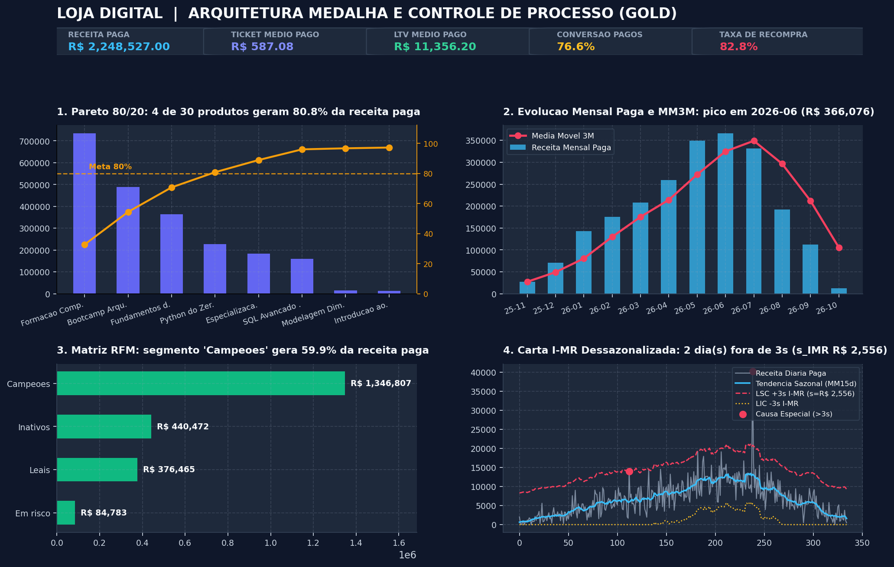
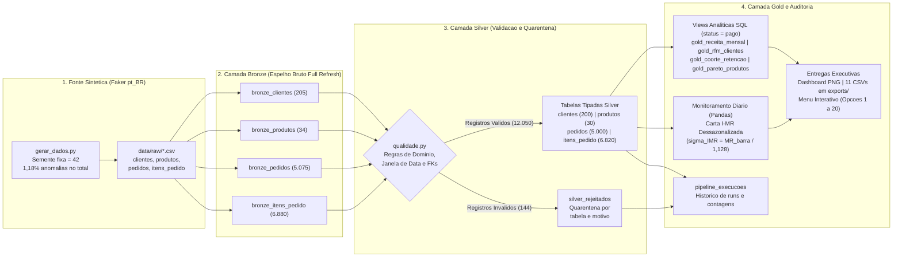
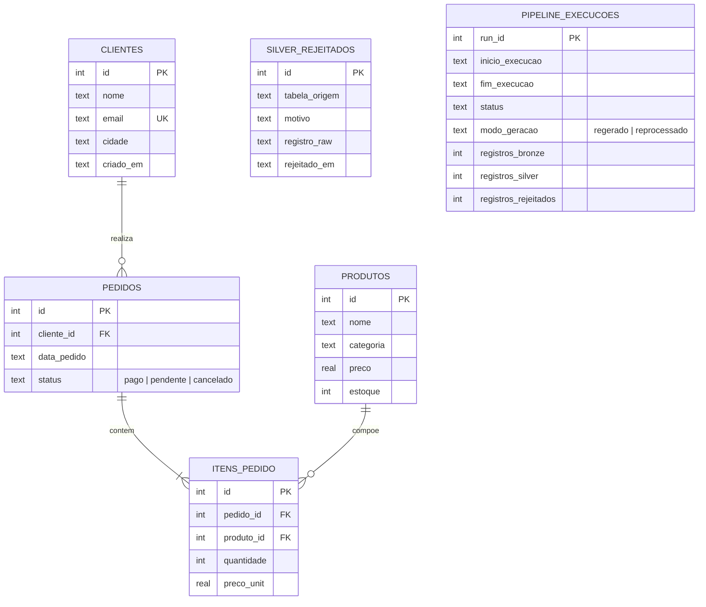

# Loja Digital: Pipeline de Engenharia de Dados em Arquitetura Medalha

[](https://github.com/Nayanearaujo/desafio-engenharia-dados-jr/actions/workflows/ci.yml)


## 1. Sobre o Projeto e Tecnologias Utilizadas

Neste projeto, construí e evoluí um pipeline de dados de ponta a ponta e um painel analítico para a **Loja Digital**, um e-commerce de produtos digitais voltado à área de tecnologia (cursos, e-books e templates).

A versão inicial atendia aos requisitos do Desafio Final da Trilha de Engenharia de Dados Júnior: aplicação em Python e SQLite com menu interativo no terminal (opções 1 a 14), modelagem relacional, consultas SQL (`JOIN`, `GROUP BY`, `HAVING`, `Subquery`, `CTE`, `Window Functions` e `View`) e 14 testes unitários.

Para evoluir a solução, mantendo a execução local simples e 100% compatível com os testes originais, implementei uma **Arquitetura Medalha (Bronze, Silver e Gold)**, com separação explícita entre geração sintética (`--pipeline`) e reprocessamento ETL (`--reprocessar`), quarentena auditável de registros inválidos (`silver_rejeitados`), histórico persistido de execuções (`pipeline_execucoes`) e camada analítica Gold reconciliada.

| Camada / Componente | Tecnologias e Recursos Aplicados |
|---|---|
| **Linguagem e Tipagem** | Python 3.11+, Type Hints, `argparse`, `logging`, configuração centralizada (`src/config.py`) |
| **Banco de Dados e SQL** | SQLite 3 (`PRAGMA foreign_keys = ON`), DDL relacional, `VIEWs`, `CTEs`, `Window Functions` (`LAG`, `RANK`, `NTILE`, `SUM/AVG OVER`) |
| **Arquitetura de Dados** | Medalha (`Bronze -> Silver -> Gold`), Quarentena (`silver_rejeitados`) e Auditoria de Execuções (`pipeline_execucoes`) |
| **Análise e Visualização** | `pandas` (séries temporais e Carta de Controle I-MR dessazonalizada), `matplotlib` (Dashboard Executivo PNG) |
| **Qualidade e CI/CD** | `pytest` (30 testes automatizados), `pytest-cov` (90%+ de cobertura em `src/`), `ruff` (lint) e **GitHub Actions** |

---

## 2. Demonstração Visual e Evidência de Execução

O painel abaixo é gerado automaticamente em `assets/dashboard_executivo.png` ao executar `python src/main.py --pipeline` (ou na opção `13` do menu interativo):



<details>
<summary><strong>Ver saída real da execução do pipeline e da suíte de testes no terminal</strong></summary>

```text
$ python src/main.py --pipeline
Inicializando banco de dados...
Banco de dados pronto!

2026-10-23 16:00:01 [INFO] pipeline.gerar_dados: Arquivo raw gerado: clientes.csv (205 linhas)
2026-10-23 16:00:01 [INFO] pipeline.gerar_dados: Arquivo raw gerado: produtos.csv (34 linhas)
2026-10-23 16:00:01 [INFO] pipeline.gerar_dados: Arquivo raw gerado: pedidos.csv (5075 linhas)
2026-10-23 16:00:01 [INFO] pipeline.gerar_dados: Arquivo raw gerado: itens_pedido.csv (6880 linhas)
2026-10-23 16:00:01 [INFO] pipeline.bronze: Camada Bronze carregada: bronze_clientes (205 linhas)
2026-10-23 16:00:01 [INFO] pipeline.bronze: Camada Bronze carregada: bronze_produtos (34 linhas)
2026-10-23 16:00:01 [INFO] pipeline.bronze: Camada Bronze carregada: bronze_pedidos (5075 linhas)
2026-10-23 16:00:01 [INFO] pipeline.bronze: Camada Bronze carregada: bronze_itens_pedido (6880 linhas)
2026-10-23 16:00:01 [INFO] pipeline.silver: bronze_clientes: 205 linhas -> silver clientes: 200 validas, 5 rejeitadas
2026-10-23 16:00:01 [INFO] pipeline.silver: bronze_produtos: 34 linhas -> silver produtos: 30 validas, 4 rejeitadas
2026-10-23 16:00:01 [INFO] pipeline.silver: bronze_pedidos: 5075 linhas -> silver pedidos: 5000 validas, 75 rejeitadas
2026-10-23 16:00:01 [INFO] pipeline.silver: bronze_itens_pedido: 6880 linhas -> silver itens_pedido: 6820 validas, 60 rejeitadas
2026-10-23 16:00:01 [INFO] pipeline.qualidade: Relatorio de qualidade gerado em exports/qualidade_rejeitados.csv (144 rejeicoes totais em 18 motivos)
2026-10-23 16:00:01 [INFO] pipeline.gold: Camada Gold atualizada com sucesso (views gold_* prontas).
2026-10-23 16:00:01 [INFO] pipeline.gold: Exportacao Gold concluida em exports (11 arquivos gerados)
2026-10-23 16:00:01 [INFO] pipeline.executar: Execucao registrada em pipeline_execucoes (run_id=1, status=sucesso, modo=regerado)

$ pytest -q && ruff check src/ tests/
30 passed in 2.41s
All checks passed!
```

</details>

---

## 3. Como Executar (Quickstart)

### 1. Clonar o repositório e instalar dependências

```bash
git clone https://github.com/Nayanearaujo/desafio-engenharia-dados-jr.git
cd desafio-engenharia-dados-jr

python3 -m venv .venv
source .venv/bin/activate
pip install -r requirements.txt
```

*(Para instalar também as ferramentas de teste e lint: `pip install -r requirements-dev.txt`. No Windows, ative com `.venv\Scripts\activate`.)*

### 2. Quatro modos de execução disponíveis

```bash
# Modo 1 (Geracao + ETL completo): Gera CSVs sinteticos em data/raw/ e executa Bronze -> Silver -> Gold + Dashboard PNG
python src/main.py --pipeline

# Modo 2 (Reprocessamento ETL): Reprocessa os CSVs ja existentes em data/raw/ sem regerar dados sinteticos
python src/main.py --reprocessar

# Modo 3 (Menu interativo): Abre o menu (opcoes 1 a 20). Se o .db nao existir ainda, inicializa com seed.sql e views Gold
python src/main.py

# Modo 4 (Demonstracao enxuta): Reinicializa o banco com o seed.sql pequeno (7 clientes, 7 produtos) e abre o menu
python src/main.py --demo
```

<details>
<summary><strong>Ver as 20 opções do menu interativo no terminal (1 a 14 originais + 15 a 20 Arquitetura Medalha)</strong></summary>

```text
==============================================================
  LOJA DIGITAL - PAINEL DE RELATORIOS E ARQUITETURA MEDALHA
==============================================================
  [ 1] Listar todos os produtos
  [ 2] Filtrar produtos por categoria
  [ 3] Listar clientes cadastrados
  [ 4] Pedidos detalhados (View SQL)
  [ 5] Ranking de produtos mais vendidos
  [ 6] Faturamento por categoria
  [ 7] Clientes por volume de compras
  [ 8] Clientes acima de meta (HAVING)
  [ 9] Produtos acima da media (Subquery)
  [10] Desempenho dos produtos (CTE + CASE WHEN)
  [11] KPIs executivos e Curva de Pareto (Window Function)
  [12] Cadastrar novo produto
  [13] Gerar Dashboard Executivo (Matplotlib)
  [14] Automatizar exportacao analitica (CSV)
  [15] Executar pipeline Medalha (Bronze -> Silver -> Gold)
  [16] Relatorio de qualidade e quarentena (Silver)
  [17] Receita mensal, MoM e media movel 3M (Gold)
  [18] Segmentacao RFM de clientes (Gold)
  [19] Taxa de recompra e retencao por coorte (Gold)
  [20] Cancelamentos e Carta de Controle 3-Sigma (Gold)
  [ 0] Sair
--------------------------------------------------------------
```

</details>

---

## 4. Arquitetura Medalha (Bronze, Silver e Gold)

O fluxo de dados segue sentido único (`Bronze -> Silver -> Gold`), com separação explícita entre a geração sintética (`gerar_dados.py`) e a ingestão/transformação ETL (`--reprocessar`). Cada execução é idempotente nas tabelas de destino e grava uma linha de auditoria em `pipeline_execucoes` (`run_id`, timestamps, modo de geração e contagens de registros lidos, válidos e rejeitados).



---

## 5. Modelo de Dados Relacional e Auditoria (Camada Silver)

Na camada Silver, o SQLite opera com `PRAGMA foreign_keys = ON`, restrições de domínio (`CHECK`, `NOT NULL`, `UNIQUE`) e tipagem definida. Os registros que violam qualquer regra na transição Bronze para Silver são isolados em `silver_rejeitados` com o registro bruto original (`registro_raw`) e o motivo da rejeição, enquanto `pipeline_execucoes` preserva o histórico de cada processamento.



---

## 6. Principais Insights, Reconciliação de KPIs e Premissas Estatísticas (Camada Gold)

> **Valores de Referência e Contrato de Status**: os números de referência abaixo são gerados com **semente `42` (`Faker 40.43.0`)**.  
> Todos os **KPIs financeiros e de clientes da camada Gold** (`Receita Paga`, `Ticket Médio Pago`, `LTV Médio Pago`, `Receita Mensal MoM`, `Matriz RFM`, `Coorte`, `Taxa de Recompra`, `Pareto Gold` e `Carta de Controle`) filtram estritamente **`status = 'pago'`**, garantindo reconciliação aritmética exata entre todos os painéis. As consultas operacionais legadas da camada Silver (opções 4, 6, 7, 10 e 11 do menu original) mantêm o filtro `status != 'cancelado'` (`pago + pendente = R$ 2.635.945,00`) para preservar o comportamento original dos testes.

| Indicador Executivo (Camada Gold) | Fórmula / Base de Cálculo (`status = 'pago'`) | Valor Reconciliado |
|---|---|---:|
| **Receita Paga Confirmada** | Soma dos itens de `3.830` pedidos pagos (`76,6%` de conversão) | **R$ 2.248.527,00** |
| **Ticket Médio Pago** | `R$ 2.248.527,00 ÷ 3.830 pedidos pagos` | **R$ 587,08** |
| **LTV Médio Pago** | `R$ 2.248.527,00 ÷ 198 clientes pagantes` | **R$ 11.356,20** |
| **Taxa de Recompra (Pagantes)** | `164 clientes recorrentes (≥ 2 compras pagas) ÷ 198 pagantes` | **82,8%** |
| **Curva de Pareto 80/20** | `4 de 30 produtos (13,3%)` somam `R$ 1.816.299,00` | **80,8% da receita paga** |
| **Pico Sazonal Mensal (`2026-06`)** | Maior faturamento mensal pago (MM3M de `R$ 324.870,33`) | **R$ 366.076,00** |
| **Dispersão de Curto Prazo ($\hat{\sigma}_{IMR}$)** | Amplitude móvel dos resíduos (`R$ 2.882,94 ÷ 1,128`) | **R$ 2.555,79** |

- **Receita Pendente e Cancelamentos**: além dos `3.830` pedidos pagos (`76,60%`), a base de referência possui **688 pedidos pendentes** (`R$ 387.418,00` / `13,76%`) e **482 pedidos cancelados** (`9,64%`, exibido como `9,6%` nas views). *(2 dos 200 clientes válidos possuem apenas pedidos pendentes/cancelados).*
- **Matriz RFM (100% reconciliada com a Receita Paga)**: a soma dos 4 segmentos fecha exatamente em **R$ 2.248.527,00**: **Campeões** (`63` clientes | **R$ 1.346.807,00** | **59,9%**), **Inativos** (`96` clientes | **R$ 440.472,00** | **19,6%**), **Leais** (`30` clientes | **R$ 376.465,00** | **16,7%**) e **Em risco** (`9` clientes | **R$ 84.783,00** | **3,8%**).

### Metodologia e Limitações Estatísticas do Monitoramento de Anomalias (Carta I-MR)

Como a receita diária possui tendência e sazonalidade acentuadas ao longo de 12 meses, uma carta de controle estática baseada no desvio-padrão amostral global ($s = 4.589{,}17\text{ BRL}$) inflaria os limites e mascararia anomalias fora do pico. Para tratar a não-estacionariedade, extraí a tendência sazonal via média móvel centrada de 15 dias ($\hat{T}_t$) e apliquei sobre os resíduos ($e_t = y_t - \hat{T}_t$) o estimador de curto prazo por **Amplitude Móvel (Carta I-MR)**:

$$\hat{\sigma}_{IMR} = \frac{\overline{MR}}{d_2} = \frac{2.882{,}94}{1{,}128} = 2.555{,}79\text{ BRL}$$

Com a banda dinâmica $\hat{T}_t \pm 3\hat{\sigma}_{IMR}$, o modelo sinaliza exatamente os **2 dias com choques sintéticos injetados na simulação**: `2026-02-28` (`R$ 14.041,00`, $Z = +3{,}16\sigma$) e `2026-07-04` (`R$ 40.227,00`, $Z = +10{,}58\sigma$).

**Premissas e limitações conhecidas da abordagem:**
1. **Efeito de borda da janela centrada (`window=15, center=True, min_periods=1`)**: nos primeiros e últimos 7 dias da série, a média móvel opera com menos de 15 observações. Além disso, como a janela é centrada (usa 7 dias passados e 7 futuros), ela é adequada para **diagnóstico histórico retrospectivo**, mas em monitoramento online em tempo real deve ser substituída por uma janela causal (retrospectiva) ou alisamento exponencial (EWMA).
2. **Influência de outliers extremos sobre a média móvel e sobre $\overline{MR}$**: um pico muito elevado (como `2026-07-04`) puxa levemente para cima a tendência local $\hat{T}_t$ nos 7 dias vizinhos e aumenta o valor médio de $\overline{MR}$. Em séries com múltiplos outliers próximos, uma evolução recomendada é estimar $\hat{T}_t$ por mediana móvel e calcular o limite a partir da mediana da amplitude móvel ($d_4 = 0{,}954$).
3. **Banda dinâmica por dia vs. limites globais de referência**: o dicionário de retorno expõe tanto os limites globais em torno da média geral (`lsc_3sigma` e `lic_3sigma` escalares) para sumário executivo quanto os vetores diários (`df["lsc_3sigma"] = tendencia + 3 * sigma_imr`) utilizados na detecção efetiva de anomalias.

---

## 7. Validação de Esquema e Quarentena de Dados (Camada Silver)

O módulo `src/pipeline/qualidade.py` aplica regras determinísticas antes da carga na camada Silver:
- **Obrigatoriedade e formato canônico de chave primária**: rejeita campos vazios, chaves não numéricas, negativas, repetidas ou em formato não canônico (como `"4.0"`).
- **Finitude e positividade numérica**: rejeita valores menores ou iguais a zero e bloqueia explicitamente `NaN` e `inf` via `math.isfinite()`.
- **Validação de calendário ISO e janela temporal de negócio**: valida datas reais (`YYYY-MM-DD`) e exige que estejam dentro da janela operacional configurada em `src/config.py` (`2020-01-01` a `2030-12-31`), bloqueando datas fora do intervalo com o motivo `data_fora_janela_negocio`.
- **Domínio de status, sintaxe/unicidade de e-mail e integridade referencial (FKs)**: garante que nenhum pedido ou item órfão chegue às tabelas analíticas.

O gerador sintético (`src/pipeline/gerar_dados.py`) injeta **144 registros inválidos em 12.194 linhas brutas (taxa global de 1,18%)**:

| Camada / Tabela | Linhas Lidas (Bronze) | Linhas Válidas (Silver) | Linhas em Quarentena (`silver_rejeitados`) | Taxa de Rejeição |
|---|---:|---:|---:|---:|
| `clientes` | 205 | 200 | 5 | 2,44% |
| `produtos` | 34 | 30 | 4 | 11,76% |
| `pedidos` | 5.075 | 5.000 | 75 | 1,48% |
| `itens_pedido` | 6.880 | 6.820 | 60 | 0,87% |
| **Total Geral** | **12.194** | **12.050** | **144** | **1,18%** |

<details>
<summary><strong>Ver detalhamento dos 144 registros bloqueados por tabela e motivo (18 combinações)</strong></summary>

| Tabela de Origem | Motivo da Rejeição (`motivo`) | Quantidade | Regra Aplicada em `qualidade.py` |
|---|---|---:|---|
| `bronze_pedidos` | `chave_duplicada` | 15 | Unicidade de chave primária (`id`) no lote |
| `bronze_pedidos` | `data_invalida:data_pedido` | 15 | Validação de calendário ISO (`YYYY-MM-DD`) |
| `bronze_pedidos` | `fk_orfa:cliente_id` | 15 | Integridade referencial contra `clientes` válidos |
| `bronze_pedidos` | `nulo_obrigatorio:cliente_id` | 15 | Preenchimento obrigatório de chave estrangeira |
| `bronze_pedidos` | `status_fora_do_dominio` | 15 | Domínio restrito a `('pago', 'pendente', 'cancelado')` |
| `bronze_itens_pedido` | `chave_duplicada` | 12 | Unicidade de chave primária (`id`) no lote |
| `bronze_itens_pedido` | `fk_orfa:pedido_id` | 12 | Integridade referencial contra `pedidos` válidos |
| `bronze_itens_pedido` | `fk_orfa:produto_id` | 12 | Integridade referencial contra `produtos` válidos |
| `bronze_itens_pedido` | `valor_menor_ou_igual_zero:preco_unit` | 12 | Regra numérica estrita (`preco_unit > 0` e finito) |
| `bronze_itens_pedido` | `valor_menor_ou_igual_zero:quantidade` | 12 | Regra numérica estrita (`quantidade > 0` e finito) |
| `bronze_produtos` | `valor_menor_ou_igual_zero:preco` | 2 | Bloqueio de preço negativo ou igual a zero |
| `bronze_produtos` | `chave_duplicada` | 1 | Unicidade de chave primária (`id`) |
| `bronze_produtos` | `nulo_obrigatorio:nome` | 1 | Preenchimento obrigatório do nome do produto |
| `bronze_clientes` | `chave_duplicada` | 1 | Unicidade de chave primária (`id`) |
| `bronze_clientes` | `data_invalida:criado_em` | 1 | Data inexistente (`2025-13-40`) |
| `bronze_clientes` | `email_duplicado` | 1 | Unicidade de endereço de e-mail (`UNIQUE`) |
| `bronze_clientes` | `email_formato_invalido` | 1 | Expressão regular para sintaxe de e-mail |
| `bronze_clientes` | `nulo_obrigatorio:nome` | 1 | Preenchimento obrigatório do nome do cliente |

</details>

---

## 8. Estrutura de Pastas

```text
desafio-engenharia-dados-jr/
├── .github/workflows/ci.yml     # Integracao Continua (Ruff + Pytest + Coverage)
├── assets/
│   └── dashboard_executivo.png  # Painel visual 4-em-1 gerado via Matplotlib
├── data/raw/                    # CSVs brutos gerados pelo Faker (ignorados no Git)
├── exports/                     # 11 tabelas analiticas Gold e quarentena em CSV
├── sql/
│   ├── bronze.sql               # DDL das tabelas brutas (full refresh) com metadados de ingestao
│   ├── schema.sql               # DDL da camada Silver + silver_rejeitados + pipeline_execucoes
│   ├── gold.sql                 # Views analiticas Gold (MoM, RFM, Coorte, Cancelamentos, Pareto)
│   └── seed.sql                 # Carga enxuta para testes unitarios e modo --demo
├── src/
│   ├── config.py                # Caminhos, semente padrao (42) e janela temporal de negocio
│   ├── main.py                  # CLI (--pipeline, --reprocessar, --demo) e menu (1 a 20)
│   ├── database.py              # Conexao SQLite (PRAGMA foreign_keys = ON) e execucao SQL
│   ├── queries.py               # Consultas SQL parametrizadas (Silver, Gold e Auditoria)
│   ├── relatorios.py            # Exibicao no terminal, exportacao CSV e Dashboard Matplotlib
│   └── pipeline/
│       ├── gerar_dados.py       # Gerador sintetico Faker("pt_BR") com semente fixa (42)
│       ├── bronze.py            # Carga bruta em modo full refresh com _ingested_at e _source_file
│       ├── qualidade.py         # Regras puras de validacao de dominio, finitude, datas e FKs
│       ├── silver.py            # Transformacao Silver, quarentena e logs de contagem
│       ├── gold.py              # Construcao de views Gold, Carta I-MR em Pandas e exportacao
│       └── executar.py          # Orquestrador run_pipeline() e registro em pipeline_execucoes
├── tests/
│   ├── test_queries.py          # 14 testes originais das consultas SQL e KPIs base
│   ├── test_qualidade.py        # 9 testes unitarios das regras de validacao e quarentena
│   └── test_pipeline.py         # 7 testes integrados do pipeline Medalha, auditoria e CLI
├── pyproject.toml
├── requirements.txt
├── requirements-dev.txt
└── README.md
```

---

## 9. Testes Automatizados e Qualidade de Código

A suíte automatizada conta com **30 testes** (`tests/test_queries.py`, `tests/test_qualidade.py` e `tests/test_pipeline.py`), atingindo **mais de 90% de cobertura** em `src/` e verificação estática limpa com `ruff`, validados automaticamente a cada push e Pull Request via GitHub Actions:

```bash
pytest --cov=src --cov-report=term-missing -v
ruff check src/ tests/
```

---

## 10. Decisões Técnicas, Limitações e Próximos Passos

1. **Prefixos de camada (`bronze_*`, `silver_rejeitados`, `gold_*`) no SQLite**: como o SQLite opera em arquivo único sem múltiplos schemas independentes, utilizei prefixos por camada mantendo os nomes originais (`clientes`, `produtos`, `pedidos`, `itens_pedido` e `resumo_pedidos`) na camada Silver para preservar compatibilidade total com os testes originais.
2. **Separação entre geração (`--pipeline`) e reprocessamento (`--reprocessar`)**: permite reprocessar os mesmos CSVs brutos de `data/raw/` sem regerar dados sintéticos, registrando cada execução na tabela `pipeline_execucoes` (`modo_geracao = 'regerado'` ou `'reprocessado'`).
3. **Limitações atuais e próximos passos**:
   - Substituir o `DROP TABLE` da camada Bronze por ingestão incremental append-only particionada por data de lote (`_batch_date`).
   - Migrar a persistência analítica local para **DuckDB** ou **PostgreSQL** mantendo o mesmo contrato de validação em `qualidade.py`.
   - Adicionar orquestração agendada e alerta automatizado quando a taxa de rejeição em `silver_rejeitados` ultrapassar o limiar operacional de `2%`.

---

## 11. Autora

**Nayane Araujo**  
[LinkedIn](https://www.linkedin.com/in/nayane-oaraujo) · [Portfólio](https://nayanearaujo.github.io/) · [GitHub](https://github.com/Nayanearaujo)
