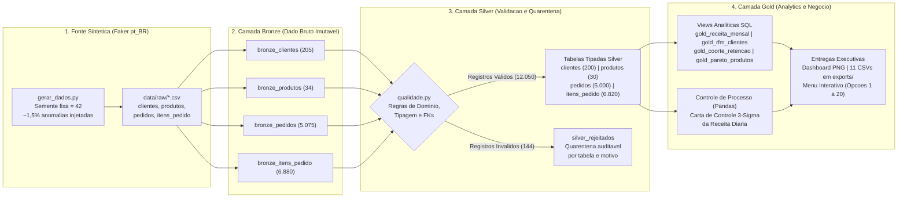
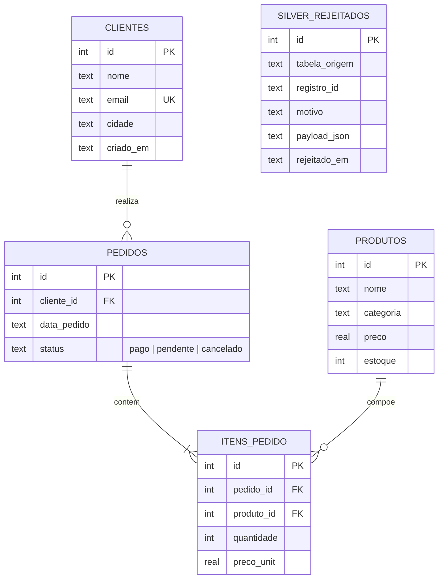

# Loja Digital: Pipeline em Arquitetura Medalha e Controle Estatístico de Processo


## 1. Sobre o Projeto e Contexto de Negócio

Neste projeto, construí e evoluí uma plataforma analítica e um pipeline de engenharia de dados para a **Loja Digital**, um e-commerce de infoprodutos voltado à área de tecnologia (cursos, e-books e templates).

A versão inicial do repositório atendia aos requisitos do Desafio Final da Trilha de Engenharia de Dados Júnior: um sistema em Python e SQLite com menu interativo no terminal (opções 1 a 14), modelagem relacional, consultas SQL (JOINs, GROUP BY, HAVING, Subquery, CTE, Window Functions e View) e testes unitários.

Para aproximar a solução de um ambiente real de engenharia de dados sem perder a simplicidade de execução local, evoluí a aplicação implementando uma **Arquitetura Medalha (Bronze, Silver e Gold)** completa. O pipeline gera dados sintéticos determinísticos para um horizonte de 12 meses de operação (`5.000` pedidos válidos), realiza ingestão bruta auditável, aplica regras formais de qualidade de dados com isolamento em tabela de quarentena (`silver_rejeitados`) e abastece uma camada analítica avançada com indicadores de crescimento mensal (MoM), segmentação RFM, retenção por coorte, Pareto 80/20 e **Controle Estatístico de Processo (Carta de Controle 3-Sigma)** inspirado na metodologia Lean Six Sigma.

---

## 2. Arquitetura Medalha (Bronze, Silver e Gold)

O fluxo de dados segue sentido único (`Bronze -> Silver -> Gold`), garantindo idempotência (executar o pipeline múltiplas vezes produz exatamente as mesmas contagens, sem duplicação) e rastreabilidade ponta a ponta via `logging`.



---

## 3. Modelo de Dados Relacional (Camada Silver)

Na camada Silver, o SQLite opera com `PRAGMA foreign_keys = ON`, restrições de domínio (`CHECK`, `NOT NULL`, `UNIQUE`) e tipagem forte. Os registros que violam qualquer regra na transição Bronze para Silver são desviados para `silver_rejeitados` contendo o payload JSON original e o motivo exato da rejeição.



---

## 4. Principais Insights de Negócio (Camada Gold)

Todos os números abaixo são extraídos diretamente da execução determinística do pipeline (`python src/main.py --pipeline`, semente `42`):

- **Receita Confirmada (Pedidos Pagos)**: **R$ 2.248.527,00** gerados em **3.830 pedidos pagos** (taxa de conversão de **76,6%** sobre os 5.000 pedidos válidos; **14,2%** pendentes e **9,2%** cancelados).
- **Ticket Médio e LTV**: ticket médio de **R$ 583,43** por pedido pago e Lifetime Value (LTV) médio de **R$ 13.179,73** por cliente ativo.
- **Concentração de Receita (Curva de Pareto 80/20)**: apenas **4 dos 30 produtos (13,3% do catálogo)** concentram **80,3% de todo o faturamento** da loja, liderados por *Formacao Completa Engenharia de Dados* (36,6% de share) e *Bootcamp Arquitetura Medalha e Lakehouse* (23,4% de share).
- **Sazonalidade e Crescimento Mensal (MoM e MM3M)**: a série histórica de 12 meses (nov/2025 a out/2026) atinge seu ponto máximo em **junho de 2026 (`2026-06`) com R$ 432.293,00** em vendas e média móvel trimestral estabilizada acima de R$ 405 mil entre maio e julho.
- **Matriz RFM e Fidelização**: a taxa de recompra global é de **82,0%** (164 clientes recorrentes em 200 clientes ativos). O segmento **Campeões** (alta recência, frequência e valor) responde sozinho por **60,2% da receita total (R$ 1.587.171,00)**.
- **Controle Estatístico de Processo (Carta de Controle 3-Sigma)**: trazendo a disciplina do **Lean Six Sigma** para a engenharia de dados, implementei uma carta de controle sobre a receita diária paga ($\mu \pm 3\sigma$) para separar variações comuns de causas especiais (como picos de lançamento ou falhas de gateway), identificando automaticamente **1 dia fora do limite superior de controle (LSC de R$ 23.278,00)** com faturamento atípico de **R$ 41.482,00**.

---

## 5. Dashboard Executivo

O painel abaixo é gerado automaticamente em `assets/dashboard_executivo.png` ao rodar o pipeline ou a opção `13` do menu:


---

## 6. Qualidade de Dados e Quarentena (Camada Silver)

O gerador sintético (`src/pipeline/gerar_dados.py`) injeta entre **1% e 3% de anomalias intencionais** nos arquivos CSV brutos para validar a resiliência da camada Silver (`src/pipeline/qualidade.py` e `src/pipeline/silver.py`). Nenhum registro inválido contamina as tabelas analíticas:

| Camada / Tabela | Linhas Lidas (Bronze) | Linhas Válidas (Silver) | Linhas em Quarentena (`silver_rejeitados`) | Taxa de Rejeição |
|---|---:|---:|---:|---:|
| `clientes` | 205 | 200 | 5 | 2,44% |
| `produtos` | 34 | 30 | 4 | 11,76% |
| `pedidos` | 5.075 | 5.000 | 75 | 1,48% |
| `itens_pedido` | 6.880 | 6.820 | 60 | 0,87% |
| **Total Geral** | **12.194** | **12.050** | **144** | **1,18%** |

### Detalhamento dos 144 Registros Bloqueados por Regra de Qualidade

| Tabela de Origem | Motivo da Rejeição (`motivo`) | Quantidade | Regra Aplicada em `qualidade.py` |
|---|---|---:|---|
| `bronze_pedidos` | `chave_duplicada` | 15 | Unicidade de chave primária (`id`) no lote |
| `bronze_pedidos` | `data_invalida:data_pedido` | 15 | Validação de calendário ISO (`YYYY-MM-DD`) |
| `bronze_pedidos` | `fk_orfa:cliente_id` | 15 | Integridade referencial contra `clientes` válidos |
| `bronze_pedidos` | `nulo_obrigatorio:cliente_id` | 15 | Preenchimento obrigatório de chave estrangeira |
| `bronze_pedidos` | `status_fora_do_dominio` | 15 | Domínio restrito a `('pago', 'pendente', 'cancelado')` |
| `bronze_itens_pedido` | `chave_duplicada` | 12 | Unicidade de chave primária (`id`) no lote |
| `bronze_itens_pedido` | `fk_orfa:pedido_id` | 12 | Integridade referencial contra `pedidos` válidos |
| `bronze_itens_pedido` | `fk_orfa:produto_id` | 12 | Integridade referencial contra `produtos` válidos |
| `bronze_itens_pedido` | `valor_menor_ou_igual_zero:preco_unit` | 12 | Regra numérica estrita (`preco_unit > 0`) |
| `bronze_itens_pedido` | `valor_menor_ou_igual_zero:quantidade` | 12 | Regra numérica estrita (`quantidade > 0`) |
| `bronze_produtos` | `valor_menor_ou_igual_zero:preco` | 2 | Bloqueio de preço negativo ou igual a zero |
| `bronze_produtos` | `chave_duplicada` | 1 | Unicidade de chave primária (`id`) |
| `bronze_produtos` | `nulo_obrigatorio:nome` | 1 | Preenchimento obrigatório do nome do produto |
| `bronze_clientes` | `chave_duplicada` | 1 | Unicidade de chave primária (`id`) |
| `bronze_clientes` | `data_invalida:criado_em` | 1 | Data inexistente (`2025-13-40`) |
| `bronze_clientes` | `email_duplicado` | 1 | Unicidade de endereço de e-mail (`UNIQUE`) |
| `bronze_clientes` | `email_formato_invalido` | 1 | Expressão regular para sintaxe de e-mail |
| `bronze_clientes` | `nulo_obrigatorio:nome` | 1 | Preenchimento obrigatório do nome do cliente |

O relatório completo é exportado automaticamente para `exports/qualidade_rejeitados.csv` e pode ser consultado na opção `16` do menu.

---

## 7. Como Executar

### 1. Clonar o repositório e preparar o ambiente virtual

```bash
git clone https://github.com/Nayanearaujo/desafio-engenharia-dados-jr.git
cd desafio-engenharia-dados-jr

python3 -m venv .venv
source .venv/bin/activate
pip install -r requirements.txt
```

*(No Windows, ative o ambiente virtual com `.venv\Scripts\activate`.)*

### 2. Três modos de execução disponíveis

```bash
# Modo 1: Executa o pipeline Medalha completo (Faker -> Bronze -> Silver -> Gold + CSVs + Dashboard PNG)
python src/main.py --pipeline

# Modo 2: Abre o menu interativo (opcoes 1 a 20) mantendo o banco atual
python src/main.py

# Modo 3: Inicializa o banco com a carga rapida de demonstracao (sql/seed.sql) e abre o menu
python src/main.py --demo
```

### Menu Interativo Completo (Opções 1 a 20)

As opções `1` a `14` originais foram integralmente preservadas, e as opções `15` a `20` adicionam a governança da Arquitetura Medalha e os novos KPIs da camada Gold:

```text
==============================================================
  LOJA DIGITAL - PAINEL DE RELATORIOS E ARQUITETURA MEDALHA
==============================================================
  [ 1] Listar todos os produtos
  [ 2] Filtrar produtos por categoria
  [ 3] Listar clientes cadastrados
  [ 4] Pedidos detalhados (View SQL)
  [ 5] Ranking de produtos mais vendidos
  [ 6] Faturamento por categoria
  [ 7] Clientes por volume de compras
  [ 8] Clientes acima de meta (HAVING)
  [ 9] Produtos acima da media (Subquery)
  [10] Desempenho dos produtos (CTE + CASE WHEN)
  [11] KPIs executivos e Curva de Pareto (Window Function)
  [12] Cadastrar novo produto
  [13] Gerar Dashboard Executivo (Matplotlib)
  [14] Automatizar exportacao analitica (CSV)
  [15] Executar pipeline Medalha (Bronze -> Silver -> Gold)
  [16] Relatorio de qualidade e quarentena (Silver)
  [17] Receita mensal, MoM e media movel 3M (Gold)
  [18] Segmentacao RFM de clientes (Gold)
  [19] Taxa de recompra e retencao por coorte (Gold)
  [20] Cancelamentos e Carta de Controle 3-Sigma (Gold)
  [ 0] Sair
--------------------------------------------------------------
```

---

## 8. Estrutura de Pastas

```text
desafio-engenharia-dados-jr/
├── .github/
│   └── workflows/
│       └── ci.yml               # Pipeline de Integracao Continua (Ruff + Pytest + Coverage)
├── assets/
│   └── dashboard_executivo.png  # Painel visual 4-em-1 gerado via Matplotlib
├── data/
│   └── raw/                     # CSVs brutos gerados pelo Faker (ignorados no Git)
├── exports/                     # 11 tabelas analiticas Gold e auditoria exportadas em CSV
├── sql/
│   ├── bronze.sql               # DDL das tabelas brutas (bronze_*) com metadados de ingestao
│   ├── schema.sql               # DDL da camada Silver tipada + silver_rejeitados + view resumo_pedidos
│   ├── gold.sql                 # Views analiticas Gold (MoM, RFM, Coorte, Cancelamentos, Pareto)
│   └── seed.sql                 # Carga enxuta para testes unitarios e modo --demo
├── src/
│   ├── main.py                  # CLI com argparse (--pipeline, --demo) e menu interativo (1 a 20)
│   ├── database.py              # Conexao SQLite (PRAGMA foreign_keys = ON) e execucao de scripts SQL
│   ├── queries.py               # Consultas SQL parametrizadas (Silver e Gold)
│   ├── relatorios.py            # Exibicao formatada no terminal, exportacao CSV e Dashboard Matplotlib
│   └── pipeline/
│       ├── __init__.py
│       ├── gerar_dados.py       # Gerador sintetico Faker("pt_BR") com semente fixa (42)
│       ├── bronze.py            # Ingestao bruta idempotente com _ingested_at e _source_file
│       ├── qualidade.py         # Regras puras de validacao de dominio, formato e FKs
│       ├── silver.py            # Transformacao Silver, quarentena e logging de linhagem
│       ├── gold.py              # Construcao de views Gold, Carta 3-Sigma em Pandas e exportacao
│       └── executar.py          # Orquestrador run_pipeline()
├── tests/
│   ├── test_queries.py          # 14 testes originais das consultas SQL e KPIs base
│   ├── test_qualidade.py        # 9 testes unitarios das regras de validacao e quarentena
│   └── test_pipeline.py         # 7 testes integrados do pipeline Medalha, idempotencia e CLI
├── .gitignore
├── requirements.txt
└── README.md
```

---

## 9. Testes Automatizados e Qualidade de Código

A suíte automatizada conta com **30 testes** distribuídos em 3 módulos (`tests/test_queries.py`, `tests/test_qualidade.py` e `tests/test_pipeline.py`), atingindo **88% de cobertura de código** em `src/` (acima da meta de 85%) e verificação estática limpa com `ruff`:

```bash
# Executar todos os testes com relatorio de cobertura
pytest --cov=src --cov-report=term-missing -v

# Verificar padrao de codigo e linting
ruff check src/ tests/
```

---

## 10. Decisões Técnicas

1. **Prefixos de camada (`bronze_*`, `silver_rejeitados`, `gold_*`) no SQLite**: como o SQLite trabalha com arquivo único sem múltiplos schemas nativos no estilo Postgres, adotei o padrão de prefixos por camada mantendo os nomes originais (`clientes`, `produtos`, `pedidos`, `itens_pedido` e `resumo_pedidos`) na camada Silver/Gold para preservar 100% de compatibilidade com os testes e relatórios legados.
2. **Idempotência por transação controlada**: cada camada limpa e recarrega seus registros dentro de transações atômicas respeitando a hierarquia de chaves estrangeiras (`itens_pedido -> pedidos -> clientes/produtos`), permitindo reprocessamentos seguros sem duplicar dados.
3. **Cálculo do Desvio-Padrão Amostral em Pandas na Camada Gold**: o SQLite nativo não possui a função agregada `STDDEV()`. Em vez de criar extensões C ou cálculos aproximados em SQL, deleguei o cálculo estatístico da Carta de Controle 3-Sigma para o `pandas` em `src/pipeline/gold.py` sobre a série agregada do SQLite, combinando o melhor de SQL e Python.
4. **Arquivos `data/raw/*.csv` e `exports/*.csv` no `.gitignore`**: para manter o repositório enxuto e evitar diffs desnecessários de milhares de linhas CSV, os dados brutos e exportações são gerados deterministicamente via `semente=42` em tempo de execução.

---

## 11. Limitações e Próximos Passos

- **Processamento em lote completo (Full Refresh)**: atualmente a transição Bronze para Silver reprocessa a janela completa de 12 meses. O próximo passo natural é implementar carga incremental por partição de data (`_ingested_at` / watermark).
- **Banco local embarcado**: o SQLite atende muito bem volumes de dezenas de milhares de registros locais, mas para concorrência de escrita e escala analítica em nuvem a evolução planejada é migrar a camada analítica para **DuckDB** ou **PostgreSQL** mantendo os contratos SQL.
- **Orquestração externa**: encapsular a chamada `python src/main.py --pipeline` em uma DAG do Apache Airflow ou Prefect com alertas automatizados caso a taxa de rejeição em `silver_rejeitados` ultrapasse o limite de controle de 3%.

---

## 12. Habilidades Demonstradas

- **Engenharia de Dados e ETL/ELT**: desenho e implementação de Arquitetura Medalha (Bronze, Silver, Gold), ingestão idempotente, metadados de auditoria (`_ingested_at`, `_source_file`) e rastreabilidade com `logging`.
- **Qualidade e Governança de Dados**: validação programática de esquemas, integridade referencial, detecção de anomalias e isolamento em tabela de quarentena (`silver_rejeitados`).
- **SQL Analítico Avançado**: `CTE (WITH)`, `Window Functions` (`LAG()`, `RANK()`, `SUM() OVER` com frame móvel `ROWS BETWEEN 2 PRECEDING AND CURRENT ROW`), `VIEWs`, `Subqueries`, `HAVING` e `CASE WHEN`.
- **Analytics e Controle Estatístico de Processo (Lean Six Sigma)**: análise de Pareto 80/20, segmentação RFM, análise de retenção por coorte, crescimento MoM e Carta de Controle 3-Sigma ($\mu \pm 3\sigma$).
- **Engenharia de Software para Dados**: testes automatizados com `pytest` e `pytest-cov` (88% de cobertura), linting com `ruff`, CLI com `argparse` e Integração Contínua com **GitHub Actions**.

---

## 13. Autora

**Nayane Araújo**  
Engenheira Química | Mestre em Data Analytics | Especialista em Qualidade e Lean Six Sigma em transição para Engenharia de Dados

- **GitHub**: [github.com/Nayanearaujo](https://github.com/Nayanearaujo)
- **Repositório do Projeto**: [github.com/Nayanearaujo/desafio-engenharia-dados-jr](https://github.com/Nayanearaujo/desafio-engenharia-dados-jr)
