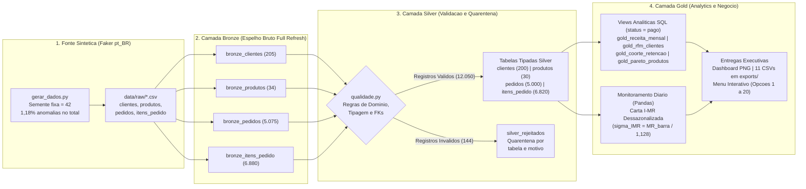
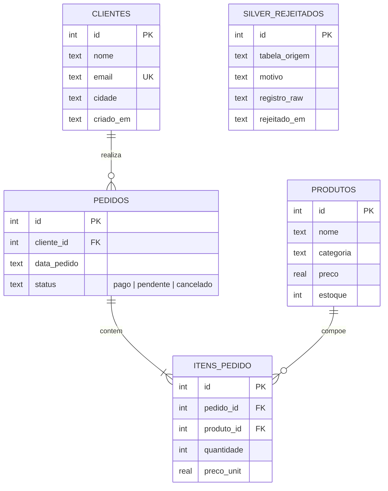

# Loja Digital: Pipeline de Engenharia de Dados em Arquitetura Medalha

[](https://github.com/Nayanearaujo/desafio-engenharia-dados-jr/actions/workflows/ci.yml)


## 1. Sobre o Projeto e Contexto de Negócio

Neste projeto, construí e evoluí um pipeline de dados e um painel analítico para a **Loja Digital**, um e-commerce de produtos digitais voltado à área de tecnologia (cursos, e-books e templates).

A versão inicial do repositório atendia aos requisitos do Desafio Final da Trilha de Engenharia de Dados Júnior: aplicação em Python e SQLite com menu interativo no terminal (opções 1 a 14), modelagem relacional, consultas SQL (JOINs, GROUP BY, HAVING, Subquery, CTE, Window Functions e View) e 14 testes unitários.

Para evoluir a solução mantendo a simplicidade de execução local e 100% de compatibilidade com o código existente, implementei uma **Arquitetura Medalha (Bronze, Silver e Gold)**. O pipeline gera dados sintéticos para 12 meses de operação (`5.000` pedidos válidos), realiza ingestão bruta espelhada do CSV, aplica regras de validação com quarentena em `silver_rejeitados` e constrói uma camada Gold com indicadores de crescimento mensal (MoM), segmentação RFM, retenção por coorte, Pareto 80/20 e monitoramento de anomalias na receita diária (Carta I-MR ajustada para sazonalidade).

---

## 2. Arquitetura Medalha (Bronze, Silver e Gold)

O fluxo de dados segue sentido único (`Bronze -> Silver -> Gold`), com execução idempotente (rodar o pipeline duas vezes em modo full refresh produz exatamente as mesmas contagens, sem duplicar registros) e logs operacionais de contagem por etapa.



---

## 3. Modelo de Dados Relacional (Camada Silver)

Na camada Silver, o SQLite opera com `PRAGMA foreign_keys = ON`, restrições de domínio (`CHECK`, `NOT NULL`, `UNIQUE`) e tipagem definida. Os registros que violam qualquer regra na transição Bronze para Silver são desviados para `silver_rejeitados` com o registro bruto original (`registro_raw`) e o motivo da rejeição.



---

## 4. Principais Insights e Reconciliação de KPIs (Camada Gold)

> **Valores de Referência e Contrato de Status**: os números de referência abaixo são gerados com **semente `42` (`Faker 40.43.0`)**.  
> Todos os **KPIs financeiros e de clientes da camada Gold** (`Receita Paga`, `Ticket Médio Pago`, `LTV Médio Pago`, `Receita Mensal MoM`, `Matriz RFM`, `Coorte`, `Taxa de Recompra`, `Pareto Gold` e `Carta de Controle`) filtram estritamente **`status = 'pago'`**, garantindo reconciliação aritmética exata entre todos os painéis. As consultas operacionais legadas da camada Silver (opções 4, 6, 7, 10 e 11 do menu original) mantêm o filtro `status != 'cancelado'` (`pago + pendente = R$ 2.635.945,00`) para preservar o comportamento original dos testes.

| Indicador Executivo (Camada Gold) | Fórmula / Base de Cálculo (`status = 'pago'`) | Valor Reconciliado |
|---|---|---:|
| **Receita Paga Confirmada** | Soma dos itens de `3.830` pedidos pagos (`76,6%` de conversão) | **R$ 2.248.527,00** |
| **Ticket Médio Pago** | `R$ 2.248.527,00 ÷ 3.830 pedidos pagos` | **R$ 587,08** |
| **LTV Médio Pago** | `R$ 2.248.527,00 ÷ 198 clientes pagantes` | **R$ 11.356,20** |
| **Taxa de Recompra (Pagantes)** | `164 clientes recorrentes (≥ 2 compras pagas) ÷ 198 pagantes` | **82,8%** |
| **Curva de Pareto 80/20** | `4 de 30 produtos (13,3%)` somam `R$ 1.816.299,00` | **80,8% da receita paga** |
| **Pico Sazonal Mensal (`2026-06`)** | Maior faturamento mensal pago (MM3M de `R$ 324.870,33`) | **R$ 366.076,00** |
| **Dispersão de Curto Prazo ($\hat{\sigma}_{IMR}$)** | Amplitude móvel dos resíduos (`R$ 2.882,94 ÷ 1,128`) | **R$ 2.555,79** |

- **Receita Pendente e Cancelamentos**: além dos `3.830` pedidos pagos (`76,60%`), a base de referência possui **688 pedidos pendentes** (`R$ 387.418,00` / `13,76%`) e **482 pedidos cancelados** (`9,64%`, exibido como `9,6%` nas views). *(2 dos 200 clientes válidos possuem apenas pedidos pendentes/cancelados).*
- **Matriz RFM (100% reconciliada com a Receita Paga)**: a soma dos 4 segmentos fecha exatamente em **R$ 2.248.527,00**: **Campeões** (`63` clientes | **R$ 1.346.807,00** | **59,9%**), **Inativos** (`96` clientes | **R$ 440.472,00** | **19,6%**), **Leais** (`30` clientes | **R$ 376.465,00** | **16,7%**) e **Em risco** (`9` clientes | **R$ 84.783,00** | **3,8%**).
- **Monitoramento de Anomalias Diárias (Carta I-MR Dessazonalizada)**: como a série diária possui sazonalidade acentuada, uma carta estática usando o desvio-padrão amostral global ($s = 4.589{,}17\text{ BRL}$) inflaria os limites e mascararia anomalias fora do pico. Para tratar a não-estacionariedade, extraí a tendência sazonal via média móvel centrada de 15 dias ($\hat{T}_t$) e apliquei sobre os resíduos ($e_t = y_t - \hat{T}_t$) o estimador de curto prazo por **Amplitude Móvel (Carta I-MR)**:
  $$\hat{\sigma}_{IMR} = \frac{\overline{MR}}{d_2} = \frac{2.882{,}94}{1{,}128} = 2.555{,}79\text{ BRL}$$
  Com a banda dinâmica $\hat{T}_t \pm 3\hat{\sigma}_{IMR}$, o modelo detecta exatamente os **2 dias com picos sintéticos injetados na simulação**: `2026-02-28` (`R$ 14.041,00`, $Z = +3{,}16\sigma$) e `2026-07-04` (`R$ 40.227,00`, $Z = +10{,}58\sigma$).

---

## 5. Dashboard Executivo

O painel abaixo é gerado automaticamente em `assets/dashboard_executivo.png` ao rodar `python src/main.py --pipeline` ou a opção `13` do menu:


---

## 6. Validação de Esquema e Quarentena de Dados (Camada Silver)

O gerador sintético (`src/pipeline/gerar_dados.py`) injeta **144 registros inválidos em 12.194 linhas brutas (taxa global de 1,18%)**. Nas tabelas cadastrais menores (`produtos` e `clientes`), injetei ao menos um exemplo de cada violação de domínio para garantir cobertura de teste de todas as regras de `qualidade.py`, o que resulta em percentuais relativos maiores nessas duas tabelas pequenas (11,76% e 2,44%) e ~1% nas tabelas transacionais (`pedidos` com 1,48% e `itens_pedido` com 0,87%):

| Camada / Tabela | Linhas Lidas (Bronze) | Linhas Válidas (Silver) | Linhas em Quarentena (`silver_rejeitados`) | Taxa de Rejeição |
|---|---:|---:|---:|---:|
| `clientes` | 205 | 200 | 5 | 2,44% |
| `produtos` | 34 | 30 | 4 | 11,76% |
| `pedidos` | 5.075 | 5.000 | 75 | 1,48% |
| `itens_pedido` | 6.880 | 6.820 | 60 | 0,87% |
| **Total Geral** | **12.194** | **12.050** | **144** | **1,18%** |

<details>
<summary><strong>Ver detalhamento dos 144 registros bloqueados por tabela e motivo (18 combinações)</strong></summary>

| Tabela de Origem | Motivo da Rejeição (`motivo`) | Quantidade | Regra Aplicada em `qualidade.py` |
|---|---|---:|---|
| `bronze_pedidos` | `chave_duplicada` | 15 | Unicidade de chave primária (`id`) no lote |
| `bronze_pedidos` | `data_invalida:data_pedido` | 15 | Validação de calendário ISO (`YYYY-MM-DD`) |
| `bronze_pedidos` | `fk_orfa:cliente_id` | 15 | Integridade referencial contra `clientes` válidos |
| `bronze_pedidos` | `nulo_obrigatorio:cliente_id` | 15 | Preenchimento obrigatório de chave estrangeira |
| `bronze_pedidos` | `status_fora_do_dominio` | 15 | Domínio restrito a `('pago', 'pendente', 'cancelado')` |
| `bronze_itens_pedido` | `chave_duplicada` | 12 | Unicidade de chave primária (`id`) no lote |
| `bronze_itens_pedido` | `fk_orfa:pedido_id` | 12 | Integridade referencial contra `pedidos` válidos |
| `bronze_itens_pedido` | `fk_orfa:produto_id` | 12 | Integridade referencial contra `produtos` válidos |
| `bronze_itens_pedido` | `valor_menor_ou_igual_zero:preco_unit` | 12 | Regra numérica estrita (`preco_unit > 0`) |
| `bronze_itens_pedido` | `valor_menor_ou_igual_zero:quantidade` | 12 | Regra numérica estrita (`quantidade > 0`) |
| `bronze_produtos` | `valor_menor_ou_igual_zero:preco` | 2 | Bloqueio de preço negativo ou igual a zero |
| `bronze_produtos` | `chave_duplicada` | 1 | Unicidade de chave primária (`id`) |
| `bronze_produtos` | `nulo_obrigatorio:nome` | 1 | Preenchimento obrigatório do nome do produto |
| `bronze_clientes` | `chave_duplicada` | 1 | Unicidade de chave primária (`id`) |
| `bronze_clientes` | `data_invalida:criado_em` | 1 | Data inexistente (`2025-13-40`) |
| `bronze_clientes` | `email_duplicado` | 1 | Unicidade de endereço de e-mail (`UNIQUE`) |
| `bronze_clientes` | `email_formato_invalido` | 1 | Expressão regular para sintaxe de e-mail |
| `bronze_clientes` | `nulo_obrigatorio:nome` | 1 | Preenchimento obrigatório do nome do cliente |

</details>

---

## 7. Como Executar

### 1. Clonar o repositório e instalar dependências

```bash
git clone https://github.com/Nayanearaujo/desafio-engenharia-dados-jr.git
cd desafio-engenharia-dados-jr

python3 -m venv .venv
source .venv/bin/activate
pip install -r requirements.txt
```

*(Para instalar também as ferramentas de teste e lint: `pip install -r requirements-dev.txt`. No Windows, ative com `.venv\Scripts\activate`.)*

### 2. Três modos de execução disponíveis

```bash
# Modo 1: Executa o pipeline Medalha completo (Faker -> Bronze -> Silver -> Gold + CSVs + Dashboard PNG)
python src/main.py --pipeline

# Modo 2: Abre o menu interativo (opcoes 1 a 20). Se o .db nao existir ainda, inicializa automaticamente com seed.sql e views Gold
python src/main.py

# Modo 3: Forca a reinicializacao rapida com o seed.sql de demonstracao e abre o menu
python src/main.py --demo
```

<details>
<summary><strong>Ver as 20 opções do menu interativo no terminal (1 a 14 originais + 15 a 20 Arquitetura Medalha)</strong></summary>

```text
==============================================================
  LOJA DIGITAL - PAINEL DE RELATORIOS E ARQUITETURA MEDALHA
==============================================================
  [ 1] Listar todos os produtos
  [ 2] Filtrar produtos por categoria
  [ 3] Listar clientes cadastrados
  [ 4] Pedidos detalhados (View SQL)
  [ 5] Ranking de produtos mais vendidos
  [ 6] Faturamento por categoria
  [ 7] Clientes por volume de compras
  [ 8] Clientes acima de meta (HAVING)
  [ 9] Produtos acima da media (Subquery)
  [10] Desempenho dos produtos (CTE + CASE WHEN)
  [11] KPIs executivos e Curva de Pareto (Window Function)
  [12] Cadastrar novo produto
  [13] Gerar Dashboard Executivo (Matplotlib)
  [14] Automatizar exportacao analitica (CSV)
  [15] Executar pipeline Medalha (Bronze -> Silver -> Gold)
  [16] Relatorio de qualidade e quarentena (Silver)
  [17] Receita mensal, MoM e media movel 3M (Gold)
  [18] Segmentacao RFM de clientes (Gold)
  [19] Taxa de recompra e retencao por coorte (Gold)
  [20] Cancelamentos e Carta de Controle 3-Sigma (Gold)
  [ 0] Sair
--------------------------------------------------------------
```

</details>

---

## 8. Estrutura de Pastas

<details>
<summary><strong>Ver árvore de arquivos do projeto</strong></summary>

```text
desafio-engenharia-dados-jr/
├── .github/workflows/ci.yml     # Integracao Continua (Ruff + Pytest + Coverage)
├── assets/
│   └── dashboard_executivo.png  # Painel visual 4-em-1 gerado via Matplotlib
├── data/raw/                    # CSVs brutos gerados pelo Faker (ignorados no Git)
├── exports/                     # 11 tabelas analiticas Gold e quarentena em CSV
├── sql/
│   ├── bronze.sql               # DDL das tabelas brutas (full refresh) com metadados de ingestao
│   ├── schema.sql               # DDL da camada Silver tipada + silver_rejeitados + view resumo_pedidos
│   ├── gold.sql                 # Views analiticas Gold (MoM, RFM, Coorte, Cancelamentos, Pareto)
│   └── seed.sql                 # Carga enxuta para testes unitarios e modo --demo
├── src/
│   ├── main.py                  # CLI com argparse (--pipeline, --demo) e menu interativo (1 a 20)
│   ├── database.py              # Conexao SQLite (PRAGMA foreign_keys = ON) e execucao de scripts SQL
│   ├── queries.py               # Consultas SQL parametrizadas (Silver e Gold)
│   ├── relatorios.py            # Exibicao no terminal, exportacao CSV e Dashboard Matplotlib
│   └── pipeline/
│       ├── gerar_dados.py       # Gerador sintetico Faker("pt_BR") com semente fixa (42)
│       ├── bronze.py            # Carga bruta em modo full refresh com _ingested_at e _source_file
│       ├── qualidade.py         # Regras puras de validacao de dominio, formato e FKs
│       ├── silver.py            # Transformacao Silver, quarentena e logs de contagem
│       ├── gold.py              # Construcao de views Gold, Carta I-MR em Pandas e exportacao
│       └── executar.py          # Orquestrador run_pipeline()
├── tests/
│   ├── test_queries.py          # 14 testes originais das consultas SQL e KPIs base
│   ├── test_qualidade.py        # 9 testes unitarios das regras de validacao e quarentena
│   └── test_pipeline.py         # 7 testes integrados do pipeline Medalha, reconciliacao e CLI
├── pyproject.toml
├── requirements.txt
├── requirements-dev.txt
└── README.md
```

</details>

---

## 9. Testes Automatizados e Qualidade de Código

A suíte automatizada conta com **30 testes** (`tests/test_queries.py`, `tests/test_qualidade.py` e `tests/test_pipeline.py`), atingindo **90% de cobertura** em `src/` e verificação estática limpa com `ruff`, validados automaticamente a cada push e Pull Request via GitHub Actions:

```bash
pytest --cov=src --cov-report=term-missing -v
ruff check src/ tests/
```

---

## 10. Decisões Técnicas e Limitações

1. **Prefixos de camada (`bronze_*`, `silver_rejeitados`, `gold_*`) no SQLite**: como o SQLite opera em arquivo único sem múltiplos schemas independentes, utilizei prefixos por camada mantendo os nomes originais (`clientes`, `produtos`, `pedidos`, `itens_pedido` e `resumo_pedidos`) na camada Silver para preservar compatibilidade total com os testes originais.
2. **Camada Bronze em Full Refresh vs. Append Imutável**: nesta implementação local, o `sql/bronze.sql` recria as tabelas brutas a cada execução (`DROP TABLE IF EXISTS`), espelhando fielmente os CSVs de entrada sem tipagem ou filtragem. Em produção, o próximo passo é substituir o full refresh por ingestão incremental append-only particionada por `_ingested_at`.
3. **Ajuste Sazonal e Carta I-MR em Pandas**: o SQLite nativo não possui funções agregadas de desvio-padrão ou janela móvel centrada com `diff()`. Além disso, o desvio-padrão amostral direto ($s$) sobre uma série sazonal superestima a dispersão natural do processo. O cálculo em `pandas` permitiu combinar decomposição por média móvel centrada (15 dias) com o estimador $\hat{\sigma}_{IMR} = \overline{MR}/1{,}128$.

---

## 11. Habilidades Demonstradas

- **Engenharia de Dados e ETL/ELT**: implementação de Arquitetura Medalha (Bronze, Silver, Gold), carga idempotente, metadados de ingestão (`_ingested_at`, `_source_file`) e logs operacionais de contagem por camada.
- **Validação de Esquema e Quarentena de Dados**: validação programática de domínio, integridade referencial, detecção de anomalias e isolamento em tabela de quarentena (`silver_rejeitados`).
- **SQL Analítico**: `CTE (WITH)`, `Window Functions` (`LAG()`, `RANK()`, `NTILE(4)`, `SUM() OVER` e `AVG() OVER` com frame móvel), `VIEWs`, `Subqueries`, `HAVING` e `CASE WHEN`.
- **Analytics e Monitoramento de Séries Temporais**: Curva de Pareto 80/20, segmentação RFM, retenção por coorte, crescimento MoM e Carta de Controle (I-MR) sobre resíduos dessazonalizados.
- **Engenharia de Software para Dados**: testes automatizados com `pytest` e `pytest-cov`, linting com `ruff`, CLI com `argparse` e Integração Contínua com **GitHub Actions**.

---

## 12. Autora

**Nayane Araujo**  
[LinkedIn](https://www.linkedin.com/in/nayane-oaraujo) · [Portfólio](https://nayanearaujo.github.io/) · [GitHub](https://github.com/Nayanearaujo)
